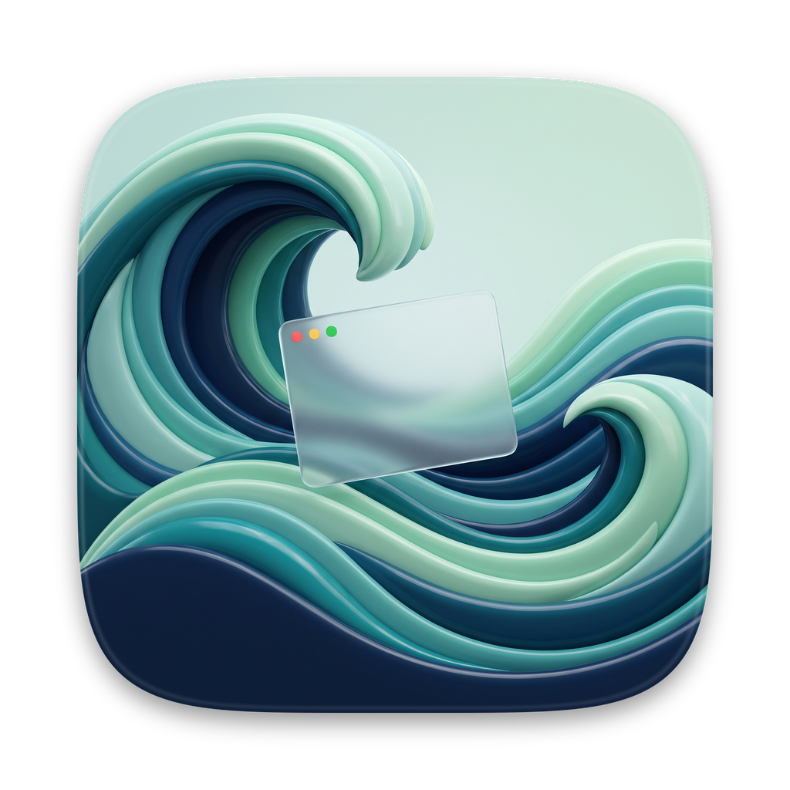

<p align="center"></p>

<h1 align="center">Tidewall</h1>

<p align="center">A live wallpaper for macOS and Windows that flows around your windows.<br>
Move a window and the world grows, parts and settles around it.</p>

https://github.com/user-attachments/assets/c33c186e-0f5f-4735-90ab-21153e9e83ce

<p align="center"><a href="https://github.com/Keshav-Madhav/tidewall/releases/latest"><b>Download Tidewall</b></a> · free for macOS 14+ and Windows 10 & 11 · <a href="https://tidewall.keshav-madhav.com/">Website</a></p>

<p align="center"></p>

Most live wallpapers are a video playing behind everything. Tidewall's walls are *places* that know where your
windows are: they become islands on an inked map, towns on a model railway, flowerbeds in a garden plan, framed
paintings on a museum wall. Drag a window and the world re-arranges itself around it, smoothly, in real time.

<p align="center"></p>

## Walls

| Wall | What it is | Cost |
|---|---|---|
| **Model Railway** | a toy railway diorama: windows become towns, trains run between them, cars wait at the level crossings | very low |
| **Garden Plan** | a landscape architect's planting plan: windows become flowerbeds, gardeners tend the paths | very low |
| **Marauders** | an enchanted castle plan on parchment; footprints follow your cursor | very low |
| **Gallery** | a museum wall: every window hangs in a real frame with a brass label, among public-domain masterpieces | none |
| **Ink Map** | a pen-and-ink archipelago; a little boat sails to your cursor | very low |
| **Celestial Atlas** | tonight's real sky over your city, as an antique star chart; windows are black holes | none |
| **Snowfall** | a painted moonlit valley; snow settles on the tops of your windows | low |
| **Lava Lamp** | soft-body wax with real buoyancy, heat and coalescence, in nine colourways | low |
| **Wind Map** | live surface wind over your country (or any other) on hand-inked relief, following day and night | medium |
| **Koi Reef** | a sunlit lagoon that grows and recedes around your windows; koi and reef fish | medium |
| **Wind Tunnel** | a real fluid simulation: smoke streams past museum-scanned models, and around your windows | high |
| **Meadow**, **Beach** | painted landscapes that part around your windows | medium to high |

**Several displays are one world.** Show a wall on more than one display and it becomes one continuous scene: trains
run, koi swim and boats sail from screen to screen; one garden, one castle plan, one sea of islands, one long museum
wall. Every wall but Lava Lamp and Wind Tunnel spans, and each display can also have its own wall.

**Your desktop icons get room too**, each wall in its own way: a village green with a hedge on the railway, a
flagstone terrace in the garden, shelves in a niche on the gallery wall, an island on the ink map and the beach, a
lily pad on the reef, a cap of snow in the valley, a dark nebula on the star chart, a cartographer's halo on the wind
map, and obstacles in the wind tunnel (which can run on your icons alone, with no model).

**Make it yours.** Settings ▸ *What the wallpaper reacts to* turns each of windows, Stage Manager, desktop widgets,
desktop icons and the pointer on or off.

## Install

### macOS

1. Download **[Tidewall.dmg](https://github.com/Keshav-Madhav/tidewall/releases/latest/download/Tidewall.dmg)**, open it and
   drag **Tidewall** onto **Applications** (or let an app-install automation take it from there).
2. Open **Tidewall** from Applications. The first time, macOS says it can't check the app for malicious software, because Tidewall
   isn't signed with a paid Apple developer certificate. Open **System Settings ▸ Privacy & Security**, scroll down,
   click **Open Anyway** and confirm. (On macOS 14 you can instead right-click the app and choose **Open**; macOS 15
   and later removed that shortcut.)
3. That's it. (Opened from somewhere else, Tidewall offers to move itself to Applications.)

You only see step 2 once. After that, updates install themselves.

Requires macOS 14 Sonoma or later, on Apple silicon or Intel.

**Updates install themselves.** Tidewall checks GitHub for new versions, verifies each download is a signed Tidewall
release, and installs it while your screen is locked (or when you choose **Restart to Update** in the menu bar). You
only see the "Open Anyway" step once. Every release is signed with the same Tidewall certificate, so macOS knows each
update is the same app and keeps what you've allowed it (Finder, for the desktop icons). Turn updates off in Tidewall's
**About** page.

Tidewall lives in the menu bar, as a little window riding a wave. Click it and choose **Open Tidewall…** for the
window, where you can try every wall on a live preview of your own desktop, give each display its own wall, and
turn on **Open at login**.

### Windows

1. Download **[Tidewall-win-x64-Setup.exe](https://github.com/Keshav-Madhav/tidewall/releases/latest/download/Tidewall-win-x64-Setup.exe)** (most PCs), or
   **[Tidewall-win-arm64-Setup.exe](https://github.com/Keshav-Madhav/tidewall/releases/latest/download/Tidewall-win-arm64-Setup.exe)** for a Windows on Arm PC (Snapdragon).
2. Run it. Windows SmartScreen says it protected your PC, because Tidewall isn't signed with a paid certificate:
   click **More info**, then **Run anyway**.
3. That's it: Tidewall installs for you alone (no administrator needed), adds itself to the Start menu and starts.

Requires Windows 10 or 11 (64-bit), with Microsoft Edge WebView2, which Windows 11 and up-to-date Windows 10 already
have. Tidewall lives in the system tray: right-click it for the walls, Pause and **Settings…**, or double-click it.
Updates install themselves, from these GitHub releases, while your screen is locked (or with **Restart to Update** in
Settings ▸ About). Uninstall it from Settings ▸ Apps like any other app.

## Light on your Mac

A wallpaper runs all day, so Tidewall is built to cost as little as possible:

- The cheap walls draw the scene once and redraw only when your windows change; trains, boats and gardeners are
  small pictures the graphics card slides around for free.
- Scenes draw at a calm 30 frames a second or less, and at 60 only while you're working on the wallpaper itself (the
  pointer over it, a window being dragged); the soft, full-screen scenes draw a little under retina, which looks the
  same at about half the work.
- Every display shares one web process.
- A screen that's fully covered stops drawing. With no mouse or keyboard input for a while (3 minutes, or 1, 10 or
  never in Settings), everything pauses; 10 minutes later (or 90 seconds after locking) the pages are let go entirely
  and a still picture stands in, until you're back.
- On battery or in Low Power Mode it can carry on as usual, draw at half the rate, or pause (Settings ▸ On battery).
- Settings ▸ Frame rate: Auto, a steady 60, or a cap of 30, 20 or 15.
- Tidewall ▸ Settings (and the menu bar menu) shows what the wallpaper costs: CPU and GPU averaged over the last minute, and memory.

## Privacy

Tidewall needs **no permissions** for anything it does by default. Window positions come from the same public list
the Dock and Mission Control use (`CGWindowListCopyWindowInfo`), and the app reads only their sizes, positions and app
names, never their contents. It doesn't record your screen, log your keys, or collect anything.

If you turn on **Desktop icons**, macOS asks once whether Tidewall may control Finder: it asks Finder only where your
desktop icons are (`desktop position of every item of desktop`), never their names or contents. Leave it off and
nothing is asked.

The only network use is **Wind Map**, which fetches public weather data for a grid over the region you chose from
[Open-Meteo](https://open-meteo.com) (no account, no identifiers). **Celestial Atlas** works out your city from your
Mac's time zone, locally.

## Something wrong?

Choose **Tidewall ▸ About ▸ Report a Problem…**. It opens a GitHub issue already filled in with what's needed to fix it
(versions, Mac model, displays, walls and settings) and puts the end of Tidewall's log on your clipboard, with your
name, folders and location taken out: paste it in if you're happy to, add what you saw, and send it. The full log is at
`~/Library/Logs/Tidewall.log`.

## Build from source

Requires the Xcode command-line tools (`xcode-select --install`).

```sh
git clone https://github.com/Keshav-Madhav/tidewall.git && cd tidewall
./build.sh                       # → build/Tidewall.app
open build/Tidewall.app
```

See [CONTRIBUTING.md](CONTRIBUTING.md) for running from source, testing walls against fake desktops, and **writing
your own wall** (a single HTML page; the host tells it where the windows are).

## Uninstall

Turn off **Open at login** in Tidewall ▸ Settings, quit Tidewall from its menu, and move the app to the Bin. Its
settings live in `~/Library/Preferences/app.tidewall.plist` and its downloads in `~/Library/Caches/app.tidewall`.

## Credits and licence

Tidewall began as a fork of [Deskland](https://github.com/BLEZZ0102/Deskland) and, like it, is licensed under the
**GNU GPL v3** (see `LICENSE` and `NOTICE`). Data, models, paintings, fonts and libraries keep their own licences:
Natural Earth, Open-Meteo, d3-celestial, three.js, the Smithsonian, NASA, Poly Haven, Khronos and The Met; see
`THIRD_PARTY_NOTICES.md`. Some textures, models and the app icon were generated for Tidewall.
