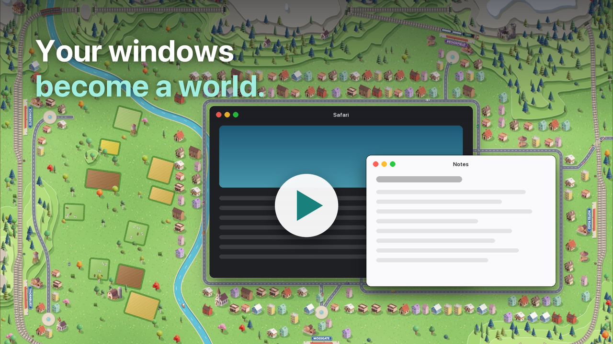
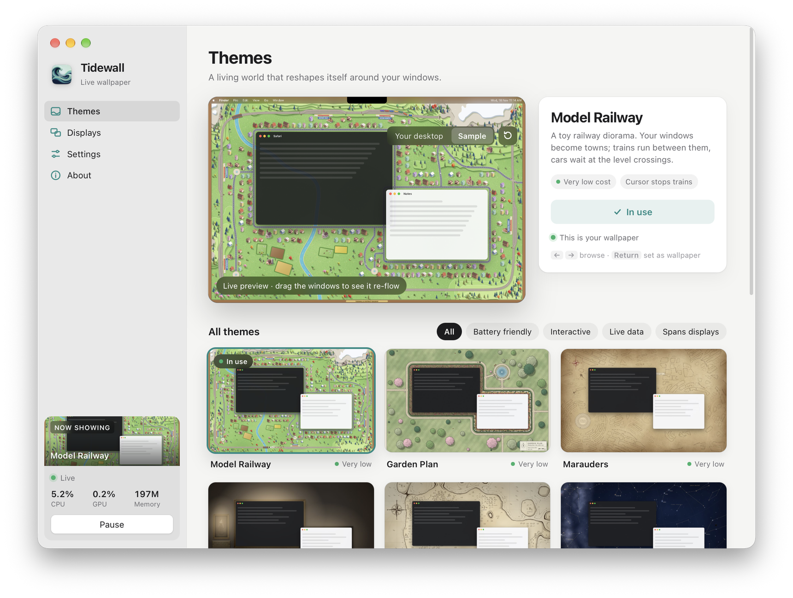
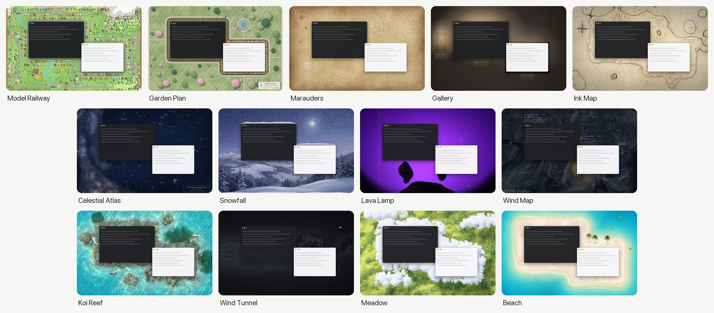

<p align="center"></p>

<h1 align="center">Tidewall</h1>

<p align="center">A live wallpaper for macOS that flows around your windows.<br>
Move a window and the world grows, parts and settles around it.</p>

<p align="center"><a href="https://github.com/Keshav-Madhav/tidewall/releases/download/v1.0.1/tidewall-promo.mp4"></a><br>
<sub><a href="https://github.com/Keshav-Madhav/tidewall/releases/download/v1.0.1/tidewall-promo.mp4">▶ Watch the 38-second film</a> · <a href="https://github.com/Keshav-Madhav/tidewall/releases/latest">Download Tidewall</a></sub></p>

<p align="center"></p>

Most live wallpapers are a video playing behind everything. Tidewall's themes are *places* that know where your
windows are: they become islands on an inked map, towns on a model railway, flowerbeds in a garden plan, framed
paintings on a museum wall. Drag a window and the world re-arranges itself around it, smoothly, in real time.

<p align="center"></p>

## Themes

| Theme | What it is | Cost |
|---|---|---|
| **Model Railway** | a toy railway diorama: windows become towns, trains run between them, cars wait at the level crossings | very low |
| **Garden Plan** | a landscape architect's planting plan: windows become flowerbeds, gardeners tend the paths | very low |
| **Marauders** | an enchanted castle plan on parchment; footprints follow your cursor | very low |
| **Gallery** | a museum wall: every window hangs in a real frame with a brass label, among public-domain masterpieces | none |
| **Ink Map** | a pen-and-ink archipelago; a little boat sails to your cursor | very low |
| **Celestial Atlas** | tonight's real sky over your city, as an antique star chart; windows are black holes | none |
| **Snowfall** | a painted moonlit valley; snow settles on the tops of your windows | low |
| **Lava Lamp** | soft-body wax with real buoyancy, heat and coalescence, in nine colourways | low |
| **Wind Map** | live surface wind over your country (or any other) on hand-inked relief, following day and night | medium |
| **Koi Reef** | a sunlit lagoon that grows and recedes around your windows; koi and reef fish | medium |
| **Wind Tunnel** | a real fluid simulation: smoke streams past museum-scanned models, and around your windows | high |
| **Meadow**, **Beach** | painted landscapes that part around your windows | medium to high |

Several displays are one desk: the sky, the wind map and the snow panorama continue across screens, and each display
can have its own theme.

## Install

1. Download `Tidewall-<version>.zip` from [Releases](../../releases) and unzip it.
2. Move **Tidewall.app** to your Applications folder.
3. Open it. The first time, macOS will say it can't check the app for malicious software, because Tidewall isn't
   signed with a paid Apple developer certificate. Open **System Settings ▸ Privacy & Security**, scroll down and
   click **Open Anyway**, then confirm. You only need to do this once. (On macOS 14 you can also right-click the app
   and choose **Open**; macOS 15 and later removed that shortcut.)

Requires macOS 14 Sonoma or later, on Apple silicon or Intel.

Tidewall lives in the menu bar, as a little window riding a wave. Click it and choose **Open Tidewall…** for the
window, where you can try every theme on a live preview of your own desktop, give each display its own theme, and
turn on **Open at login**.

## Light on your Mac

A wallpaper runs all day, so Tidewall is built to cost as little as possible:

- The cheap themes draw the scene once and redraw only when your windows change; trains, boats and gardeners are
  small pictures the graphics card slides around for free.
- Every display shares one web process.
- A screen that's fully covered stops drawing. With no mouse or keyboard input for 3 minutes, everything pauses; after
  10 minutes (or 90 seconds after locking) the pages are let go entirely and a still picture stands in, until you're
  back.
- Tidewall ▸ Settings shows what the wallpaper is costing right now: CPU, GPU and memory.

## Privacy

Tidewall needs **no permissions**. Window positions come from the same public list the Dock and Mission Control use
(`CGWindowListCopyWindowInfo`), and the app reads only their sizes, positions and app names, never their contents. It
doesn't record your screen, log your keys, or collect anything.

The only network use is **Wind Map**, which fetches public weather data for a grid over the region you chose from
[Open-Meteo](https://open-meteo.com) (no account, no identifiers). **Celestial Atlas** works out your city from your
Mac's time zone, locally.

## Build from source

Requires the Xcode command-line tools (`xcode-select --install`).

```sh
git clone https://github.com/Keshav-Madhav/tidewall.git && cd tidewall
./build.sh                       # → build/Tidewall.app
open build/Tidewall.app
```

See [CONTRIBUTING.md](CONTRIBUTING.md) for running from source, testing themes against fake desktops, and **writing
your own theme** (a single HTML page; the host tells it where the windows are).

## Uninstall

Turn off **Open at login** in Tidewall ▸ Settings, quit Tidewall from its menu, and move the app to the Bin. Its
settings live in `~/Library/Preferences/app.tidewall.plist`.

## Credits and licence

Tidewall began as a fork of [Deskland](https://github.com/BLEZZ0102/Deskland) and, like it, is licensed under the
**GNU GPL v3** (see `LICENSE` and `NOTICE`). Data, models, paintings, fonts and libraries keep their own licences:
Natural Earth, Open-Meteo, d3-celestial, three.js, the Smithsonian, NASA, Poly Haven, Khronos and The Met; see
`THIRD_PARTY_NOTICES.md`. Some textures, models and the app icon were generated for Tidewall.
